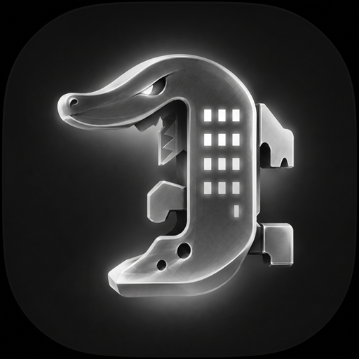
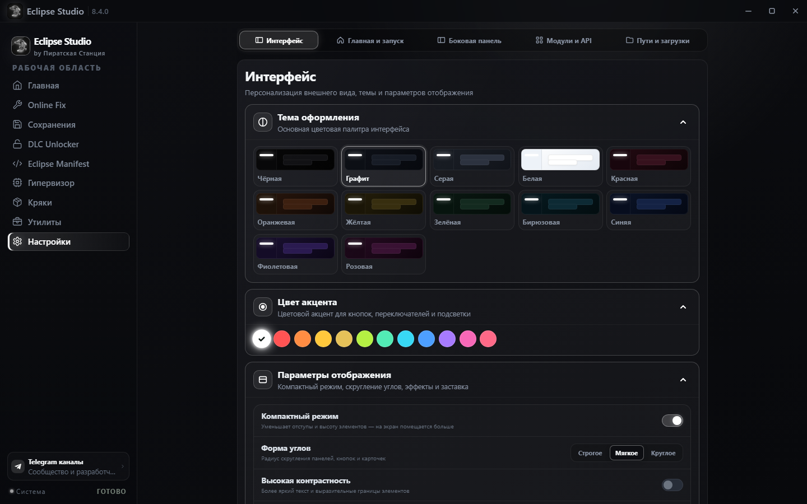

<div align="center">



# Eclipse Studio

**Автономный центр управления Steam-библиотекой, дополнениями, сетевыми фиксами и системной средой**

[](https://github.com/Sparki1337/eclipse-studio/releases/latest)
[-0078D6?style=for-the-badge&logo=windows&logoColor=white)](https://microsoft.com/windows)
[](#-о-проекте)
[](https://tauri.app/)
[](https://github.com/Sparki1337/eclipse-studio/releases/latest)
[](#-безопасность-и-приватность)

<p align="center">
  <a href="https://github.com/Sparki1337/eclipse-studio/releases/latest"><b>⚡ Скачать последнюю версию</b></a> •
  <a href="https://sparki1337.github.io/eclipse-studio/"><b>🌐 Официальный сайт</b></a> •
  <a href="https://t.me/piratestationn"><b>💬 Telegram-канал</b></a> •
  <a href="BUILD.md"><b>🛠️ Сборка из исходников</b></a>
</p>

---

<p align="center">
  
</p>

</div>

## 🌒 О проекте

**Eclipse Studio** — это легковесное и быстрое приложение на базе **Rust (Tauri v2)**, объединяющее все ключевые инструменты для работы с играми Steam в одном удобном интерфейсе. Программа автоматизирует рутинные задачи, которые раньше требовали десятка сторонних утилит и ручной правки конфигураций: разблокировку DLC, настройку кооператива по сети, резервное копирование сохранений, установку Depot-манифестов и управление системными режимами защиты Windows.

Проект является глубоким развитием и форком *Crocodile Gena Studio* (автор **LeoBanned**), полностью переписанным с упором на скорость, автономность и эстетику:
- **Нативный Rust-бэкенд**: основные дисковые, сетевые и системные операции реализованы на Rust. Отдельные интеграции и защищённый backend плагина используют PowerShell; длительные операции выполняются как задания с явным результатом.
- **Portable-дистрибутив**: приложение распространяется одним EXE без установщика. Настройки, зашифрованное состояние и журналы хранятся в профиле Windows; изменения Steam, игр и системных режимов выполняются отдельными подтверждёнными действиями. Portable не означает отсутствие записей на диск.
- **Поддержка процессоров с AVX2 (старых и новых)**: приложение рассчитано на работу с процессорами, поддерживающими набор инструкций **AVX2** — от классических линеек (начиная с Intel Haswell 4-го поколения и AMD Excavator/Zen) до новейших многоядерных чипов (AMD Ryzen Zen 3 / Zen 4 / Zen 5, Intel 12–14+ поколений, Core Ultra).
- **Глубокая интеграция с Windows**: современные проводниковые диалоги `IFileOpenDialog` и Drag & Drop (`WM_DROPFILES`), корректно работающие сквозь разные уровни прав UAC.
- **Продуманный UI**: 14 цветовых тем, 12 неоновых акцентов (в светлой теме — с читаемым контрастом), масштабирование шрифтов (85%–140%), компактный режим, настраиваемая ширина сайдбара, настраиваемая главная и выбор раздела при запуске.

---

## 🧩 Ключевые возможности

### 🛠️ Universal Online Fix
* **Сетевая игра и кооператив**: автоматическая настройка сетевых эмуляторов через Spacewar (AppID `480`) или кастомные лобби (Cube Racer, SteamVR и др.).
* **Интеллектуальный анализ папки игры**: автоматическое определение исполняемого файла, архитектуры (`x86` / `x64`), наличия библиотек Steam и типа игрового движка (Unreal Engine 4/5, Unity, CryEngine).
* **Поддержка Epic Online Services (EOS)**: проверка состояния `EOSSDK-Win64-Shipping.dll`, установка адаптированного эмулятора EpicFix и мгновенный откат к оригиналу.
* **Автоматический бэкап**: перед изменением любых библиотек создаётся побайтовая копия в каталоге `.backup_orig`.

### 🔑 DLC Unlocker (SmokeAPI & CreamAPI)
* **SmokeAPI (v4.1.3, рекомендуется)**: современный метод разблокировки через размещение DLL-прокси (`version.dll`, `winhttp.dll` или `winmm.dll`) рядом с файлом игры. Файлы клиента Steam остаются полностью нетронутыми.
* **CreamAPI**: проверенный классический метод с подменой `steam_api.dll` / `steam_api64.dll`, автоматическим созданием резервных копий и опцией **Extra Protection** для обхода внутренних проверок цифровой подписи игры.
* **Сводный каталог DLC**: глубокое сканирование установленных игр на всех дисках через парсинг `libraryfolders.vdf` и локального бинарного кэша `appinfo.vdf` с подгрузкой данных из Steam Store API (включая скрытые и делистинговые дополнения).

### 💾 Менеджер сохранений (Save Manager)
* **Глубокий поиск в 15+ источниках**: сканирует системные каталоги (`Saved Games`, `Documents`, `LocalAppData`, `LocalLow`, `AppData`), пользовательские профили Steam (`userdata`), а также структуры популярных эмуляторов и групп (Goldberg, CODEX, EMPRESS, RUNE, FLT, TENOKE, OnlineFix).
* **Фильтр временных файлов**: автоматически отсекает кэш шейдеров, логи крашей, дампы памяти и временные данные, сохраняя только чистый игровой прогресс.
* **Экспорт и архивация**: упаковка в ZIP или сжатый RAR с формированием встроенного манифеста точных системных путей.
* **Безопасное восстановление**: распаковка сохранений строго по оригинальным путям с встроенной защитой от выхода за пределы каталогов (Anti-Path Traversal).

### 📜 Eclipse Manifest & Загрузка манифестов
* **Интеграция с источниками манифестов (Ryuu & HubCap)**: прямой поиск и загрузка файлов через сервисы **HubCap** (рекомендуется для стабильной работы без блокировок, с отслеживанием лимита) и **Ryuu Generator** (с поддержкой авторизации по API-ключу).
* **Автоматическая раскладка**: перемещение `.lua`-скриптов в `config/stplug-in/` и `.manifest` в `depotcache/` без ручных действий.
* **Встроенный OpenSteamTool (v1 и v2)**: переключение между основной (v0.5.3, 1.58 МБ) и альтернативной версиями загрузчика, поддержка Схемы 2 файловой структуры и автозавершение зависших процессов Steam для предотвращения ошибок занятости файлов (`os error 32`).
* **Локальное облако (CloudRedirect)**: сохранения игр, добавленных через Lua и манифесты, синхронизируются как облачные, но хранятся в выбранной папке на вашем диске — без Google Drive, OneDrive и регистрации. Включается одним переключателем: программа проверяет совместимость загрузчика OpenSteamTool, делает резервную копию `opensteamtool.toml`, откатывает изменения при ошибке и сама перезапускает Steam. Обычные игры Steam продолжают пользоваться своим облаком.
* **Плагин для Millennium («Eclipse Manifest» v5.5.0)**: встроенный плагин, добавляющий кнопку «Получить манифест» прямо на страницы игр внутри официального клиента Steam.

> [!TIP]
> **Если генератор Ryuu выдаёт ошибку недоступности**: домен `generator.ryuu.lol` часто блокируется сетевой веб-защитой антивирусов (например, ESET Smart Security / NOD32) или провайдерами. Чтобы разрешить доступ, добавьте адрес `*generator.ryuu.lol*` в список разрешённых URL в настройках антивируса, либо переключитесь на альтернативный встроенный сервис **HubCap** прямо в интерфейсе программы.

### 🛡️ Гипервизор и системная защита (Eclipse-HV)
* **Автономный лаунчер Eclipse-HV v2**: написан на чистом Rust для запуска игр с динамическим обходом Driver Signature Enforcement (DSE) в оперативной памяти без отключения Secure Boot в UEFI. Модульная архитектура из 7 шагов: полное журналирование (`Eclipse-HV.log`), структурированные отчёты об ошибках с журналом сессии (`Eclipse-HV-error.json`), обработка Ctrl+C с аварийным восстановлением состояния.
* **Собственный DSE-движок на Rust**: доступ к памяти ядра через встроенный подписанный драйвер RTCore64.sys, временная подмена `CiValidateImageHeader` (SeCiCallbacks+0x20) на `ZwFlushInstructionCache` с сохранением исходного значения в реестре и гарантированным восстановлением после запуска игры; смещения ядра разрешаются динамически (кэш → drivers.ini → PDB с сервера символов Microsoft); служба драйвера не остаётся в системе.
* **Диагностика и тестовая подпись Eclipse-HV**: режим `--status` — осмотр системы без изменений (HVCI, VBS, режим тестовой подписи, XCR0, конфликтующие службы и процессы, сертификат, состояние DSE) с JSON-отчётом `Eclipse-HV-status.json`; подкоманды `cert install / remove / sign / status` — собственный тестовый сертификат подписи кода «Eclipse-HV Test CA» для загрузки своих драйверов в режиме тестовой подписи Windows.
* **Нативные ярлыки игр на рабочем столе**: автоматическое создание ярлыков Windows (`.lnk`) с иконкой игры на рабочем столе через Windows Shell COM API (`IShellLinkW`). Опция включена по умолчанию и настраивается в интерфейсе (переключатель в заголовке библиотеки и в настройках, кнопки создания/удаления в карточках игр).
* **Системная диагностика и ремонт Windows (WMI, SFC, DISM)**: раздельные неразрушающие проверки (`/verifyrepository`, `/verifyonly`, `/scanhealth`) и автоматический ремонт с восстановлением повреждённых файлов и хранилища компонентов Windows через Windows Update, с потоковым выводом лога в реальном времени.
* **Защита доступа с повышением прав UAC**: доступ к вкладкам «Управление защитами» и «VBS 2.0» строго ограничен сессиями с правами администратора. При входе без прав открывается удобное диалоговое окно для моментального перезапуска от имени администратора.
* **Настраиваемый запуск от администратора**: в «Настройки → Главная и запуск → Запуск программы» есть переключатель, включённый по умолчанию. При обычном запуске готовой Windows-сборки запрашивается UAC; опцию можно выключить. Отмена UAC оставляет обычный интерфейс открытым без цикла перезапусков. [Поведение и исключения](docs/STARTUP-ADMIN.md).
* **UEFI Opt-Out (`SecConfig.efi`)**: подготовка снятия UEFI Lock возвращена с отдельным согласием, DPAPI-журналом до изменений и проверяемым откатом. Используются собственные уникальные EFI-каталог и BCD-запись, без перезаписи системного `SecConfig.efi` и чужой одноразовой очереди загрузки. После перезапуска требуется подтверждение на экране компьютера. [Порядок работы и ограничения восстановления](docs/UEFI-RECOVERY.md).
* **Проверка BitLocker / Device Encryption**: загрузочные операции блокируются, если состояние шифрования неизвестно. Активная защита приостанавливается на одну перезагрузку и перепроверяется перед изменениями UEFI. Это не гарантирует отсутствие запроса ключа восстановления: заранее нужен доступный ключ. Возврат исходных UEFI Lock требует отдельного согласия и перезагрузки.
* **Адаптация инструкций Denuvo (XSAVE / XCR0)**: полная поддержка процессоров с AVX2. Встроенный фикс автоматически устраняет сбои и вылеты игр с Denuvo на современных процессорах с инструкциями AVX-512 (AMD Ryzen Zen 4/Zen 5, Intel 12+ поколений) без ручных команд в BCD.
* **Аудит и очистка античитов**: глубокий поиск остаточных служб и драйверов 12 популярных античит-систем (EAC, BattlEye, Vanguard, FACEIT, EA AntiCheat, PunkBuster, XIGNCODE3, GameGuard, ACE, TrueProtect, Denuvo AC, EQU8) с обязательным бэкапом реестра перед удалением.
* **Управление VBS и Test Mode**: проверка Virtualization-based Security (VBS), изоляции ядра (HVCI) и тестового режима Windows со снимками поддерживаемых изменений. Неизвестные, смешанные и старые EFI-снимки не откатываются вслепую.

### 📦 Каталог кряков (Crack Vault)
* **Облачная синхронизация**: автоматическое получение актуального каталога проверенных релизов и библиотек.
* **Многопоточный загрузчик**: параллельное скачивание файлов в 6 потоков с контролем скорости, возможностью паузы и отображением в Проводнике.
* **Умная автоустановка в 1 клик**: определение структуры архивов (ZIP/RAR), поиск вложенных каталогов с бинарниками игры, создание бэкапов и удаление архива после завершения.

### 🧰 Внешние утилиты
* Быстрый запуск и инструкции по настройке вспомогательного софта: **Zapret2** (обход замедлений и разрывов соединений игровых серверов), **CirnoDownloader** и **Sigma**.

### 🏠 Главная и персонализация
* **Сводка на главной**: недавние игры, последние резервные копии, незавершённые операции и блок «Требует внимания» с переходом в нужный раздел; карточки модулей идут в том же порядке, что и в боковой панели.
* **Настраиваемая главная**: блоки можно скрывать и переставлять, выбирать карточки модулей, длину списков (3, 4, 6 или 8 строк) и показ номеров операций; скрытые уведомления возвращаются одной кнопкой, историю можно очистить. Кнопка «Настроить главную» открывает вкладку **Настройки → Главная и запуск**.
* **Раздел при запуске**: главная, последний открытый раздел или любой модуль, включая вкладки Гипервизора («Античиты», «VBS 2.0»). Если выбранный раздел скрыт в боковой панели, откроется главная.
* **Светлая тема без потери акцентов**: яркие акценты автоматически заменяются более тёмными оттенками того же цвета с контрастом не ниже 4.5:1 (белый становится графитовым); цвета статусов тоже адаптированы.

---

## ⚡ Сравнение с оригиналом

| Возможность / Параметр | Crocodile Gena Studio (Оригинал) | Eclipse Studio (Форк) |
| :--- | :--- | :--- |
| **Формат дистрибутива** | Сборка с сопутствующими скриптами и утилитами | **100% Standalone Portable single EXE** |
| **Архитектура бэкенда** | Смешанный скриптовый бэкенд | **Чистый Rust (Tauri v2)**: высокий отклик и лёгкость |
| **Выбор директорий** | Диалоги браузера или WinForms | **Нативный Explorer COM-диалог (`IFileOpenDialog`)** |
| **Drag & Drop папок** | Ограничен в WebView2 при elevated-правах | **Нативный перехватчик `WM_DROPFILES`** сквозь UAC |
| **Ярлыки на рабочем столе** | Базовая интеграция / запуск через лаунчер | **Нативные `.lnk` через Shell COM API (`IShellLinkW`)** с автосозданием и удалением |
| **Диагностика и ремонт Windows** | Пакетные команды восстановления | **Раздельная диагностика и ремонт WMI, SFC, DISM** с живым потоковым логом |
| **Безопасность BitLocker и UEFI** | Стандартный системный перезапуск | Проверка BitLocker; отдельные EFI/BCD-объекты, DPAPI-журнал, проверяемый откат и явное согласие на UEFI relock |
| **Установка кряков** | Скачивание в Загрузки и ручная распаковка | **Автоустановка в 1 клик**: умный разбор структуры и бэкап |
| **Поддержка OpenSteamTool** | Единственная внешняя версия | **Двойной встроенный загрузчик (v1 / v2) + Схема 2** |
| **Автообновление** | Встроенный апдейтер через отдельную утилиту `CgsUpdater.exe` | **Обновление в 1 клик без сторонних утилит**: проверка SHA-256 из релиза GitHub, замена EXE на месте (ярлыки и путь сохраняются), откат при сбое и напоминание через 5 запусков |
| **Интерфейс и темы** | Базовые темы (до 125% масштабирования) | **14 тем оформления**, 12 неоновых акцентов, зум 85%–140%, настраиваемая главная |

---

## 🛡️ Безопасность и приватность

Приложение разработано по принципу максимального уважения к пользовательской системе:

1. **Никаких скрытых изменений**: новые операции движка, архивного установщика и CreamAPI сохраняют первый оригинал в `.backup_orig` с SHA-256 и хешем установленной версии. Старые sidecar-бэкапы `_o.dll` без проверяемого журнала сохраняются для ручного разбора.
2. **Проверяемый откат**: перед восстановлением проверяются оригиналы и текущие версии файлов. Внешние изменения блокируют перезапись; общий откат охватывает весь журнал. Старые неподтверждённые файлы не удаляются автоматически.
3. **Безопасность SmokeAPI**: анлокер использует уникальные прокси-имена и при деинсталляции удаляет строго свои файлы, никогда не затрагивая системные DLL Windows.
4. **0% телеметрии**: portable-приложение не собирает аналитику, не отправляет логи на сторонние сервера и хранит конфигурацию локально. Запросы к Steam, GitHub, Ryuu и HubCap выполняются для соответствующих функций; это не офлайн-режим и не подтверждение отсутствия сетевых запросов.

---

## 🚀 Быстрый старт

> [!NOTE]
> **Аппаратные требования**: требуется процессор с поддержкой инструкций **AVX2** (поддерживаются как старые линейки CPU, начиная с Intel Core 4-го поколения Haswell и AMD Zen / Excavator, так и новейшие современные платформы).

1. Перейдите в раздел **[Releases](https://github.com/Sparki1337/eclipse-studio/releases/latest)** и скачайте актуальный файл `Eclipse-Studio-v10.1.0.exe`.
2. Поместите исполняемый файл в любую удобную папку (установка не требуется).
3. Запустите приложение (для доступа к функциям VBS, Test Mode и реестру Steam рекомендуется запуск от имени администратора).

---

## 🛠️ Сборка из исходного кода

Для самостоятельной компиляции потребуются **Node.js 22.12+**, **Rust (x64 Windows MSVC)** и **Visual Studio C++ Build Tools**.

```powershell
# 1. Клонируйте репозиторий:
git clone https://github.com/Sparki1337/eclipse-studio.git
cd eclipse-studio

# 2. Установите зависимости интерфейса:
npm install

# 3. Соберите портативный релиз в один клик:
python scripts/build.py
```

**Структура репозитория:**
```text
eclipse-studio/
├── ui/                 # Интерфейс: core/, features/, styles/, assets/
├── src-tauri/          # Rust-бэкенд (Tauri v2); бинарные ресурсы — в src-tauri/resources/
├── eclipse-hv/         # Автономный лаунчер Eclipse-HV (отдельный Rust-крейт)
├── eclipse-manifest/   # Плагин Millennium «Eclipse Manifest»
├── millenium/          # Файлы клиента Millennium
├── scripts/            # build.py, bump_version.py, release.py и служебные скрипты
├── tests/              # Проверки контрактов и тесты интерфейса (npm test)
├── third_party/        # Исходники встроенных сторонних компонентов (CloudRedirect, MIT)
└── docs/               # Сайт на GitHub Pages
```

> [!TIP]
> Подробное пошаговое руководство по настройке инструментов и компиляции доступно в файле [**BUILD.md**](BUILD.md).

---

## ⌨️ Полезные горячие клавиши

* <kbd>F5</kbd> / <kbd>Ctrl</kbd> + <kbd>R</kbd> — быстрое обновление данных активного модуля.
* <kbd>Esc</kbd> — закрытие любых модальных окон, логов и выпадающих меню.
* Перетаскивание папки игры на окно программы мгновенно открывает её в модуле **Online Fix** или **DLC Unlocker**.

---

## 👥 Авторы и благодарности

* **Sparki** ([@Sparki1337](https://github.com/Sparki1337)) — автор и разработчик форка Eclipse Studio.
* **LeoBanned** ([@LeoBanned](https://github.com/LeoBanned)) — автор оригинального проекта Crocodile Gena Studio.
* Участникам сообщества **Пиратской Станции** за тестирование, поддержку и предоставление базы релизов.

### Сообщество и каналы связи:
* 📢 **[Пиратская Станция в Telegram](https://t.me/piratestationn)** — новости, релизы и обсуждение.
* 💬 **[Eclipse Studio / Sparki](https://t.me/gde_sparki)** — личный Telegram разработчика.
* 🐊 **[Crocodile Hub](https://t.me/crocodilehub2)** — группа поддержки оригинального проекта.

---

## ⚖️ Дисклеймер

Программное обеспечение предоставляется исключительно в ознакомительных, исследовательских и образовательных целях для изучения архитектуры приложений Windows, взаимодействия динамических библиотек и системной виртуализации. Разработчики не несут ответственности за возможные последствия использования данного ПО или нарушение пользовательских соглашений сторонних сервисов.

<div align="center">

**Eclipse Studio v10.1.0** • 2026

</div>
